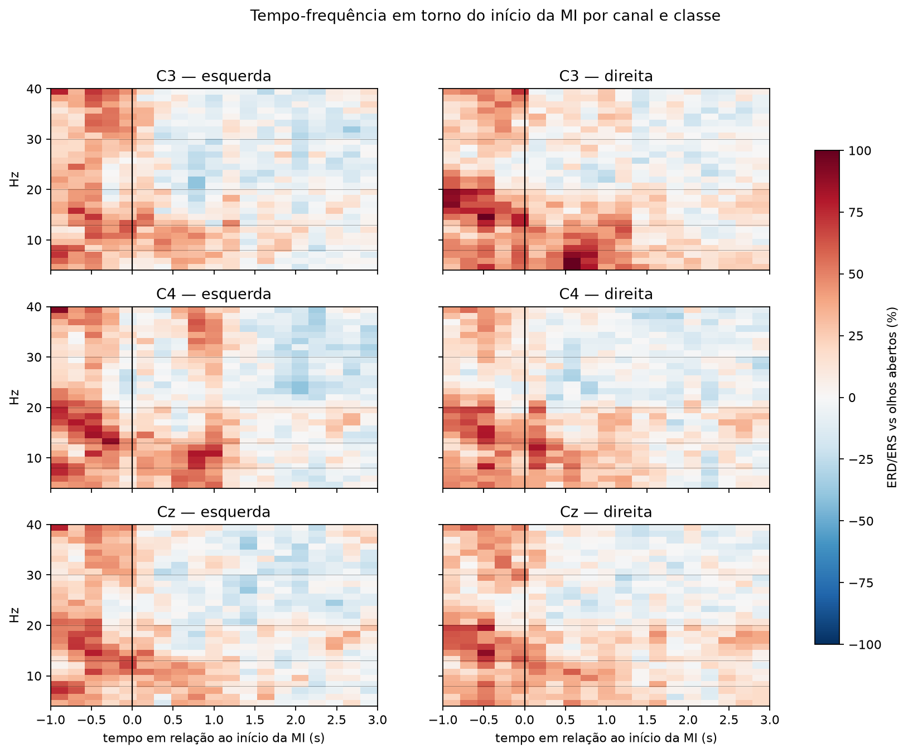
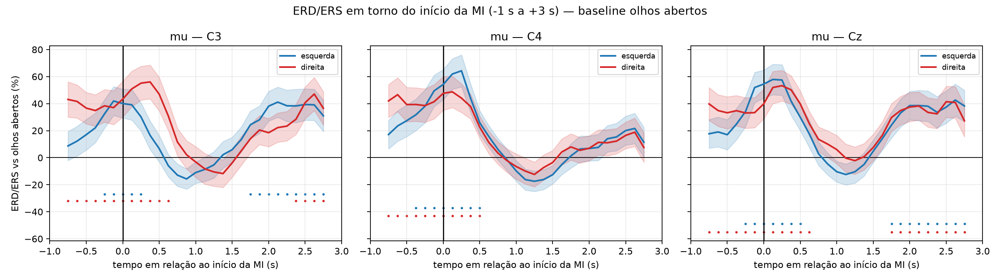

# Rascunho para a tese — métodos e resultados da validação

> **Status:** rascunho para revisão do autor. Não foi inserido no LaTeX da tese.
> Fontes: relatórios em `docs/validation/` (19/11/2026; atualizado em
> 27/11/2026 com a subseção 5.4).

---

## 1. Aquisição e geometria

O rig é composto por um Kinect v2 (RGB + profundidade, referência principal)
e duas webcams auxiliares: **aux0 SIGMA-W780M** e **aux1 Trust USB**. A
calibração é feita com tabuleiro 8×6 quadrados de 45 mm (7×5 cantos internos).

A calibração vigente foi coletada após a remontagem das câmeras auxiliares:

| item | RMS | poses |
|---|---:|---:|
| intrínsecas do Kinect (congeladas) | 0,631 px | — |
| aux0 SIGMA-W780M | 1,699 px | 15 |
| aux1 Trust USB | 1,158 px | 15 |

A convenção é `X_aux = R·X_kin + T`, com o 3D expresso no referencial da câmera
de cor do Kinect. A correção depth→cor usa o arquivo
`configs/calibracao/kinect_depth_para_cor.npz` (PnP, resíduo ~1,9 px).

**Limitação:** os conjuntos de calibração tinham poucas poses inclinadas
(2/15); a próxima calibração deve incluir mais inclinações (20–45°) e o
tabuleiro na distância de trabalho da mão (1,0–1,4 m).

---

## 2. Vídeos offline das auxiliares

Foram gravados vídeos H.264 a 1280×720, com timestamps por frame e
sincronização manual (tecla **S**) por flash/clap. O sincronismo manual
produziu offset de +16 ms e resíduo de 0 ms na sessão validada.

O processamento offline:

1. lê os vídeos e os timestamps;
2. roda MediaPipe HandLandmarker em cada vista;
3. casa as mãos por lado/geometria;
4. triangula o par aux0↔aux1 (DLT, `triangulate_pair_points`);
5. aplica gate de reprojeção e atribui `track_id` por continuidade 3D;
6. grava `landmarks_3d.csv/npz`, `coverage_report` e `meta_processado`.

Na sessão `teste_sync3`, com uma mão e `--num-hands 1`:

- 112 registros;
- reprojeção nas auxiliares: **1,37 / 1,40 px**;
- cobertura por junção: mínimo 49,1%, mediana 75,9%;
- dois tracks (0 e 1) e 27 registros sem ponto 3D válido no trecho intermediário.

Com `--num-hands 2`, a mesma sessão gerou 187 registros e 143 trocas
intercaladas de lado — evidência de detecção duplicada/falsa; para uma mão,
deve-se usar `--num-hands 1`.

---

## 3. Qualidade do 3D

Foi implementado um controle de qualidade (`qc_landmarks3d.py`) com:

- cobertura por junção;
- reprojeção;
- jitter (segunda diferença);
- comprimento de cada osso, com CV bruto e robusto.

No processamento offline de uma mão:

```text
CV de comprimento de osso mediano: 2,66%
CV robusto (mediana ± 3 MAD):      1,20%
```

No online, o par aux0↔aux1 mostrou reprojeção de 1,9–2,5 px, mas o CV subiu
para ~10–11%; o Kinect depth teve CV de 73–151%, dominado por outliers. A
razão mediana de comprimento por osso Kinect/par ficou em 1,02–1,05, sem viés
global de escala. Conclusão: o Kinect depth não é referência limpa para
rigidez; a triangulação do par é o baseline atual.

---

## 4. Protocolo EEG

O protocolo é ME→MI no mesmo trial:

```text
repouso 2 s | cue 1 s (L/R) | ME 4 s | transição 1 s | MI 4 s | ITI 1–2 s
```

A janela do decoder é sempre recortada **dentro da MI**, sem atravessar
ME→MI. O treino é adaptativo por bloco (CSP+LDA, score contínuo
`2·P(direita) − 1`, dificuldade ajustada por BA) e a sessão final usa o
decoder **congelado**.

Plano: 3 sessões × 20 trials/classe (2 blocos de 10/classe), total de 60
trials/classe; sessões 1–2 de treino e sessão 3 de teste congelado.

---

## 5. Resultados do piloto (17/11)

### 5.1 CSP+LDA cross-sessão

| tarefa | s01→s02 | s02→s01 |
|---|---:|---:|
| ME | 0,633 | 0,750 |
| MI | 0,550 | 0,533 |

ME é decodificável; MI permanece próxima do acaso.

### 5.2 Espectro (MI 4 s, 60 L + 60 R)

- mu 8–13 Hz: sem diferença L/R; pico ~10,5 Hz;
- beta 13–30 Hz: C4 levemente menor à direita (−0,49 dB; p=0,022 **não
  corrigido**; d=−0,38), sem pico beta destacado;
- banda total: padrão lateralizado fraco e instável entre sessões.

### 5.3 Feedback L/R adaptativo

- treino s01: BA 0,700 (calibração) e 0,533 (adaptação);
- teste congelado s02: **BA=0,567, IC95% [0,437; 0,688]**, n=60;
- veredito: **não-respondedor** pelo critério pré-fixado.

---

### 5.4 ERD/ERS e representação tempo-frequência do piloto (atualização 27/11/2026)

Esta subseção substitui a leitura espectral preliminar da subseção 5.2 para
a questão de ERD/ERS. Foram usados os 120 trials do piloto (60 mão esquerda,
60 mão direita), das sessões s01 e s02, nos canais C3, C4 e Cz.

**Protocolo de análise.** O baseline foi o bloco de olhos abertos de 60 s
do início de cada sessão (marcadores 901→903). A janela de interesse foi
definida em torno do **início da MI** (marcador 780):

```text
[início da MI − 1 s, início da MI + 3 s]
```

Essa janela cobre o último segundo da transição ME→MI e os primeiros três
segundos da MI. O intervalo nominal da transição ME→MI foi de **1,0 s**
(`transicao_sec = 1,0`), confirmado nos eventos gravados
(`mi_start − me_end ≈ 1,015 s`). Os sinais foram filtrados em 4–40 Hz e
reamostrados para 128 Hz. A potência foi calculada em janelas de 0,5 s
(passo 0,125 s); o ERD/ERS foi definido por

```text
ERD/ERS(%) = 100 × (P_MI(t)/P_olhos_abertos − 1)
```

e testado contra zero com teste t de uma amostra e correção FDR ao longo do
tempo. A representação tempo-frequência usou espectrograma de Welch
(nperseg = 64, sobreposição 48) e a mesma normalização pelo baseline de
olhos abertos.

**Resultados.** A Figura 5.4.1 mostra o mapa tempo-frequência médio por canal
e por classe; a Figura 5.4.2 mostra o curso temporal de mu e beta baixo.



*Figura 5.4.1 — ERD/ERS médio (%, relativo a olhos abertos) em torno do início
da MI. Linhas: C3, C4 e Cz; colunas: mão esquerda e mão direita. Azul = ERD;
vermelho = ERS. A janela vai de −1 s a +3 s em relação ao início da MI.*



*Figura 5.4.2 — Curso temporal do ERD/ERS em mu (8–13 Hz), média ± erro
padrão, por canal e classe. A linha vertical marca o início da MI.*

Na banda **mu (8–13 Hz)**, o padrão dominante foi de **ERS** (potência acima
do baseline de olhos abertos), particularmente na transição e no início da MI.
O ERD em mu foi transitório e modesto: na janela de 1–2 s após o início da MI,
o maior valor foi −7,0% em C4 para a mão esquerda, sem significância; não se
observou um ERD alto e bilateral em mu.

Na banda **beta baixo (13–20 Hz)**, observou-se **ERD robusto** após o início
da MI. Na janela de 1–2 s, os valores foram:

| canal | mão esquerda | mão direita |
|---|---:|---:|
| C3 | −21,8%* | −19,1%* |
| C4 | −21,1%* | −24,8%* |
| Cz | −22,8%* | −19,1%* |

`*` = p < 0,05 contra olhos abertos.

O ERD em beta baixo persistiu na janela de 2–3 s (entre −11,8% e −23,1%,
conforme o canal e a classe). Em **beta alto (20–30 Hz)** também houve ERD,
mas com padrão menos homogêneo entre canais e classes.

**Sobre a lateralização.** A leitura visual da Figura 5.4.1 pode sugerir uma
dissociação do tipo “C4 na mão esquerda / C3 na mão direita”. A quantificação,
entretanto, **não confirmou** essa dupla dissociação:

- o ERD em mu foi bilateral e, numericamente, maior na mão esquerda tanto em
  C3 quanto em C4;
- em beta baixo, o ERD foi bilateral e de magnitude semelhante nas duas
  classes;
- não houve um padrão contralateral limpo e consistente entre as bandas.

Assim, os dados sustentam a **presença de ERD/ERS** — sobretudo ERD em beta
baixo —, mas não sustentam uma assinatura lateralizada simples em C3/C4 na
média por eletrodo. A classificação FBCSP pode explorar combinações espaciais
e temporais que não aparecem na média univariada dos canais; essa hipótese será
testada no espaço dos componentes CSP.

**Relação com a ME.** A transição ME→MI ainda apresenta ERS em relação ao
baseline de olhos abertos, e a janela pós-cue inicial é dominada pela ME. Por
isso, a análise de MI deve ser ancorada no marcador 780 e não no cue inicial;
os resultados de ME não podem ser interpretados como evidência de imagética
motora.

**Limitações.** O baseline de olhos abertos é um bloco de 60 s no início da
sessão, não imediatamente antes de cada trial; há apenas três canais; não houve
EMG simultâneo; e o número de trials é pequeno (120). Os efeitos são
exploratórios e devem ser confirmados nas 3 sessões completas.

<!-- FIGURAS DA SUBSECAO: docs/thesis/figures/fig_erd_ers_tf.png,
     fig_erd_ers_mu.png, fig_erd_ers_beta_low.png -->

---

## 6. Discussão e limitações

- 1 participante, 2 sessões do mesmo dia no piloto;
- 3 canais (C3/C4/Cz), sem topografia;
- p-valores exploratórios, sem correção múltipla;
- sem ICA/rejeição de artefatos/EOG;
- Kinect depth com outliers; não tratar como verdade absoluta;
- HandMvNet não foi treinado do zero: sem checkpoint, o baseline de
  triangulação é mais defensável.

O conjunto é consistente com a literatura de BCI illiteracy: o usuário
consegue modular ME, mas não MI de forma robusta com 3 canais.

---

## 7. Próximos passos

1. calibrar novamente as auxiliares na distância de trabalho, com mais poses;
2. rodar o protocolo completo de 3 sessões;
3. manter o teste congelado como métrica final;
4. registrar não-respondedor se o IC inferior da BA continuar <0,55;
5. só adotar HandMvNet se houver checkpoint ou ganho comprovado sobre a
   triangulação.
